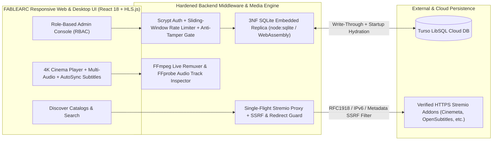

<div align="center">
  
  <h1>FABLEARC</h1>
  <p><strong>Security-Hardened Cloud & Desktop Cinema Streaming Platform</strong></p>
  <p>
    
    
    
    
    
    
  </p>
</div>

---

## Overview

**FABLEARC** is a full-stack, security-hardened cinema streaming application and media center engineered with a **Midnight Navy & Electric Aqua-Cyan** design system. It combines a declarative Stremio addon protocol engine, an on-the-fly **FFmpeg 4K UHD & Multi-Audio remuxing pipeline**, a **Single-Flight L1/L2 caching proxy**, and a **3rd-Normal-Form (3NF) SQLite + Turso Cloud Embedded Replica** database (~378 bytes per active user).

---

## System Architecture



---

## Key Engineering Highlights

### 1. 4K UHD & Multi-Audio Live FFmpeg Streaming Pipeline
- **On-the-Fly Container Remuxing (`/api/media-stream`)**: Copies `H.264`/`HEVC` video bitstreams with zero quality loss (`-c:v copy`) while transcoding incompatible `EAC3` / `AC3` / `TrueHD` surround audio into browser-native stereo `AAC` in real time.
- **Language-Priority Audio Track Selection (`/api/media-probe`)**: Probes multi-audio MKV/MP4 containers via `ffprobe` and automatically sorts audio tracks with priority to **English $\rightarrow$ Hindi $\rightarrow$ Other languages** while preserving exact FFmpeg `0:a:<index>` stream mappings.
- **Decreasing Quality & Multi-Audio Stream Ranking**: Automatically ranks discovered streams from `4K UHD (2160p)` $\rightarrow$ `1080p FHD` $\rightarrow$ `720p HD` $\rightarrow$ `SD`, prioritizing `Multi-Audio` and `Dual Audio` releases within each resolution tier.

### 2. Ultra-Compact 3NF SQLite + Turso Cloud Embedded Replica
- **~378 Bytes Per Active User**: Normalizes providers (`provider_registry`) and media metadata (`media_catalog`) globally using `WITHOUT ROWID, STRICT` join tables (`user_providers`, `user_watch_history_v2`, `user_watchlist_v2`) and automatic Metahub URL compression.
- **Sub-Millisecond Reads + Cloud Durability**: Serves reads from the local SQLite replica in `< 0.1ms` while pipelining writes asynchronously to **Turso Cloud (`/v2/pipeline`)** and hydrating state automatically on cold container startups.
- **Cross-Runtime SQLite Engine**: Uses Node 22's native `node:sqlite` locally and transparently falls back to WebAssembly SQLite (`node-sqlite3-wasm`) on Node 20 cloud containers with zero native C++ ABI issues.

### 3. Defense-in-Depth Security Architecture (Strix E2E Verified)
- **Exhaustive SSRF & Open-Redirect Protection**: Blocks loopback (`127.0.0.0/8`, `::1`), RFC 1918 private LANs (`10.0.0.0/8`, `172.16.0.0/12`, `192.168.0.0/16`), CGNAT (`100.64.0.0/10`), AWS/GCP/Alibaba cloud metadata (`169.254.169.254`, `100.100.100.200`, `metadata.google.internal`, `fd00:ec2::254`), IPv6-mapped IPv4 (`[::ffff:127.0.0.1]`), octal/hex/integer IPs, and validates every HTTP `301/302/307/308` redirect hop manually.
- **Authentication, Session Revocation & RBAC**:
  - `scrypt` password hashing with timing-safe verification (`timingSafeEqual`) and HTTP response hash masking (`scrypt$<salt>…$REDACTED`).
  - `HttpOnly; SameSite=Strict` session cookies + `Bearer` token authentication.
  - Immediate session revocation across SQLite, in-memory `sessionCache`, and Turso Cloud upon password change, admin password reset, or role change.
  - Sliding-window brute-force rate limiting (`429 Too Many Requests` + `Retry-After`) on `/api/auth/login` and `/api/auth/change-password`.
- **FFmpeg Process Isolation**: Enforces `-protocol_whitelist http,https,tcp,tls,crypto`, argument flag guards, and a strict per-user concurrency cap (`MAX_ACTIVE_STREAMS_PER_USER = 2`).

### 4. Cinema Player, Subtitle AutoSync & Responsive Design
- **Non-AI Subtitle AutoSync & SDH Filter**: WebVTT/SRT parser with one-click Hearing-Impaired (`[SDH]`) bracket stripping and cue-capture delay synchronization.
- **Mobile-First Responsive UI**: Adaptive layouts across desktop (`1440px+`), tablet (`768px`), and mobile (`480px`) viewports with touch-optimized player controls and aspect-ratio crop cycling (`Fit`, `Fill`, `16:9`, `21:9`, `2.39:1`, `4:3`).

---

## Project Structure

```text
├── public/                     # FABLEARC vector favicon & brand assets
├── scripts/
│   └── manage-users.mjs        # CLI tool for user provisioning & Turso Cloud sync
├── src/
│   ├── addons/
│   │   └── stremioProtocol.ts  # Declarative Stremio protocol, Single-Flight L1 cache & stream ranker
│   ├── components/
│   │   ├── AdminDashboardView.tsx  # Admin RBAC console, user & addon management, DB diagnostics
│   │   ├── AuthGatePage.tsx        # Anti-tamper authentication gate modal
│   │   ├── CinemaPlayerModal.tsx   # 4K HLS/MP4/MKV player, audio/subtitle/crop popovers & Watch Party
│   │   └── PlatformLogoEmblem.tsx  # Custom SVG FABLEARC brand emblem & platform medallions
│   ├── player/
│   │   └── subtitleEngine.ts   # WebVTT/SRT parser, SDH stripper & AutoSync calculator
│   ├── security/
│   │   └── securityGuards.ts   # SSRF validator, sliding-window rate limiter & external player guard
│   ├── server/
│   │   ├── redisCacheEngine.ts # Single-Flight L1 LRU + L2 Redis cache engine
│   │   └── streamzDb.ts        # 3NF SQLite + Turso Cloud replica database
│   ├── App.tsx                 # Main application shell, Discover catalog grid & state sync
│   └── styles.css              # Midnight Navy & Electric Aqua-Cyan responsive design system
├── tests/
│   ├── securityAndPlayer.test.ts   # 16 unit & integration tests (Security, Addons, Subtitles, 3NF DB)
│   └── strixSecurityE2E.test.ts    # 8 full-stack Strix E2E security & user-journey tests
└── vite.config.ts              # Backend API middlewares, Stremio proxy & FFmpeg transcode pipeline
```

---

## Quick Start

### 1. Install Dependencies
```bash
npm install
```

### 2. Configure Environment (Optional for Cloud Sync)
Copy `.env.example` to `.env` and add your free [Turso Cloud](https://turso.tech) credentials:
```env
TURSO_DATABASE_URL=libsql://your-db-name-your-username.turso.io
TURSO_AUTH_TOKEN=your-turso-auth-token
```

### 3. Run the Automated Test Suite (`24 / 24 Tests`)
```bash
npm test
```

### 4. Start Development or Production Build
```bash
# Start local development server (http://localhost:5173)
npm run dev

# Build for production
npm run build

# Start production server
npm start
```

---

## CLI User Management

Manage users or push local database state to Turso Cloud using the included CLI utility:

```bash
# List all registered users
npm run db:users -- list

# Create or update an administrator account
npm run db:users -- create --email=admin@fablearc.com --name="Admin" --password="StrongPassword1!" --role=admin

# Sync local SQLite tables to Turso Cloud
npm run db:users -- sync-turso
```
